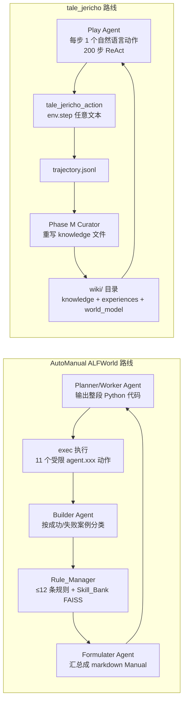

# AutoManual × tale_jericho 衔接分析报告

日期:2026-08-21
对象:[minghchen/automanual](https://github.com/minghchen/automanual)(NeurIPS 2024, commit `aeb17e4`)
本地路径:`~/automanual`(已部署验证)

---

## 一、部署结果

### 环境(已完成)

| 组件 | 状态 |
|---|---|
| conda env `py39`(Python 3.9.16) | `~/miniconda3/envs/py39` |
| TextWorld 1.3.2(MarcCote handcoded fork)+ jericho 3.3.1 | 已装 |
| fast_downward 20.6 | 已装(需 cmake + `CMAKE_POLICY_VERSION_MINIMUM=3.5`) |
| alfworld 0.2.2(仓库内置 fork,editable 安装) | 已装 |
| torch 2.8.0+cpu / transformers 4.41 / langchain 0.3 / faiss-cpu / openai 1.35.3 | 已装 |
| ALFWorld 数据(`json_2.1.1` train + valid_unseen + logic) | 随仓库自带,65MB |

### 部署时打的补丁(重要)

上游代码 2024 年后依赖漂移,以下补丁使其在今天可跑:

1. **gym 0.26 兼容层** `site-packages/gym/envs/registration_compat.py`(+ `sitecustomize.py` 自动加载):
   - textworld 1.3.2 期望老 API `registry.env_specs` → 给 dict registry 加属性别名;
   - alfworld 的 `gym.make(env_id)` 未传 `disable_env_checker` → 默认关闭 PassiveEnvChecker(老 textworld env 无 action_space 会被 assert 拒绝)。
2. **依赖钉版本**:spacy 3.7.5 / thinc 8.2.5 / numpy<2(gym 0.26 与老 textworld 都要求);httpx 0.27.2 + httpcore 1.0.9 + openai 1.35.3(openai 的 `proxies=` 参数与新 httpx 冲突);flask 1.1.4(兼容 click 7);补齐 langchain 全家桶的传递依赖(uuid_utils、tenacity、h2、zstandard、SQLAlchemy 等)。
3. **visdom / ai2thor 等重依赖**:ai2thor 链(flask/xlib/msgpack/boto3…)只为 import 通过,headless 服务器无需真跑 THOR;visdom 直接移除。

### 冒烟验证(全部通过)

- `main_build.py --help` / `main_test.py --help` 正常;
- ALFWorld AlfredTWEnv 创建 + reset:54 个 train games,首局 `pick_clean_then_place_in_recep-Apple-None-Fridge-27`;
- `InteractEnv.step("go_to('fridge_1')")` 返回观测正常;
- 仓库自带的 `gpt4preview_autobuildcase_manual` 可被 `Rule_Manager.load()` 加载(10 条规则 + markdown manual + 6 条 skill);
- worker 的 helper 函数(`find_object` 等)由 `run_trail` 显式注入 `local_vars`,不依赖规则 example 的 fence 解析,链路正确。

**尚未验证**:真实 LLM 调用(build/test 三阶段需要 `OPENAI_API_KEY`/`OPENAI_BASE_URL`,可用你现有的 OpenAI 兼容端点如 `https://codeyu.shop/v1` 或 GLM;`ChatGPT_API.py` 是标准 openai>=1.0 客户端,配好环境变量即可)。

---

## 二、两个系统的架构对照

| 维度 | AutoManual(ALFWorld) | tale_jericho(你的系统) |
|---|---|---|
| 环境接口 | 受限 Python API:`agent.go_to/open/take_from/...`(11 个固定方法,`env_history.py:script_transform` 白名单) | 自由文本命令:`env.step('go north')` 任意动词名词(`tale_jericho_tools.py:tale_jericho_action`) |
| 动作空间 | 封闭:对象带 ID(`mug_1`),动词可枚举 | 开放:不可枚举,靠 `admissible_commands` 提示 |
| 决策粒度 | 一次生成整段代码,最多 3 次重规划(`MAX_REPLAN_STEP=3`),50 步上限 | 每步一个动作,单次尝试 200 步(`DEFAULT_PLAY_LOOPS=200`) |
| 反馈信号 | `info['won']` 二值成败 | `score/max_score` 连续 + `won/lost`(`score_rate`) |
| 任务结构 | 6 类模板任务,`task_type` 可作规则的作用域 | 每游戏一个长 horizon 任务,无任务类型 |
| 知识载体 | `all_rules` dict(≤12 条,超限触发 Consolidator 合并)+ Skill_Bank(FAISS)+ 最终 Manual(markdown) | wiki 目录:`knowledge/`(评分配方)+ `experiences/`(按日期追加)+ `world_model/`(房间/对象) |
| 知识注入方式 | **可执行**:规则里的 helper 代码被 `define_functions_from_rules` exec 进 worker 的 local scope,worker 直接调用 | **提示级**:wiki_memory_read 检索 markdown 片段进上下文;另有 FATAL 硬拦截(工具层 `_check_fatal_action`)和 wm 图谱(query_wm) |
| 提炼触发 | 每个 epoch 结束,Builder 按直间成功/失败三分支提炼 | 每次尝试结束,phase_m 全量重写 knowledge 文件 |

---

## 三、结论:能否衔接?

**直接跑:不能。** AutoManual 官方只支持 ALFWorld / MiniWoB++ / WebArena,没有 Jericho 适配,且其核心假设与 Jericho 特性有三处硬冲突:

1. **动作接口假设不成立**。整个 Planner 体系(worker prompt、few-shot 示例、`script_transform` 白名单、`Agent` 类的 11 个方法)都建立在"封闭受限 API"上。Jericho 是自由文本命令空间,同一动作在不同房间效果相反(detective 里 `go north` 一处 +10 一处即死),AutoManual 没有"位置条件化动作"的概念。
2. **任务结构假设不成立**。规则系统以 `task_type`(6 类)为作用域、以 50 步内 `won` 二值信号为提炼依据;Jericho 单任务数百步、连续分数、部分可观测,`direct_success/indirect_success` 三分支提炼和 `MAX_REPLAN_STEP=3` 的节奏都不适用。
3. **知识表示不兼容**。AutoManual 的规则 example 是可执行 Python(依赖 `agent.go_to` 等 API 存在),在 Jericho 上没有对应执行语义。

**间接衔接:可行且有价值。** 两者是同一命题(交互式经验→结构化知识→提升后续表现)的两代实现,复用方向按成本从低到高:

### 路线 A:借思想(推荐,零代码)
AutoManual 相对你现有 wiki 管线有三个可直接吸收的设计:
- **规则上限 + 合并器**:你目前 knowledge 文件只控 800 词,无条目级生命周期;AutoManual 的 12 条上限、`validation_record` 滚动验证记录(仅保留最近 3 次)、Consolidator 合并,可直接写进 phase_m 的 prompt 约束。
- **三分支提炼**:你现在的 curator 只区分"有/无进步";AutoManual 的 Imperfect Rules vs Imperfect Agent 分类(失败归因于知识缺失还是执行偏差)能避免 wiki 无限膨胀。
- **Manual 公式化阶段**:你缺一个 build→formulate 的两段式;在多次尝试后把 knowledge 配方公式化为面向新手的结构化 manual,与 wiki 原始条目分离,通常能提升可迁移性。

### 路线 B:换环境后端(中等成本,约 2–4 天)
把 AutoManual 移植到 tale-suite Jericho,需要写一个 `jericho_env_history.py` 替代 `env_history.py`:
- `Agent` 类改为透传任意命令:`def do(self, cmd): return self.observation(cmd)`;
- `InteractEnv` 改用 `tales/jericho` 的 gymnasium 接口(你 `tale_jericho_tools.py:569 _start_session` 已有现成范式,含 dictionary-bug 补丁);
- `is_success` 从 `info['won']` 改为 `score_rate` 阈值;
- worker/builder/formulater prompt 全部按自由文本动作空间重写(参照你 `apps/tale_jericho/prompts/system_prompt.txt` 的 SURVIVAL FIRST 段);
- Skill_Bank 的代码型 skill 改为"动作序列配方"(存文本序列而非可执行函数)。
代价:几乎重写 prompts 目录与 env_history,AutoManual 剩下可复用的只有 Rule_Manager/Skill_Bank 骨架和 Builder 三分支流程。

### 路线 C:互导知识产物(低成本,一次性脚本)
两边知识格式可机械转换:
- AutoManual rules/markdown manual → 你的 wiki `knowledge/`(规则=条目,example=配方);`rule_manager.json` 是纯 JSON,直接脚本转换即可;
- 你的 wiki → AutoManual init_rules:写一个转换脚本把 `score_recipe_*.md` 的 Scoring Path 逐行变成 "Success Process" 规则、Death Traps 变成 "Special Mechanism" 规则。注意 AutoManual worker 不能直接消费 [FATAL] 标记(那是你工具层的拦截机制),需要在其 exec 层加等价 guard,否则导入的知识只对提示有效。

### 与你 ablation 体系的对接点
你的 abl2–abl22 消融(no_wiki / no_knowledge / no_experiences / no_world_model / react)对应 AutoManual 消融的天然映射:autobuild(无规则)、autobuild_case(全量)、skill_bank only。若论文要做 AutoManual 基线对比,路线 B 是必要投入;若只借方法论强化 wiki 管线,路线 A+C 即可。

---

## 四、风险与注意事项

1. **老栈隔离**:py39 环境是完整独立的 conda env,勿与你的 `venv_biagentsci`(py3.12, tales/textworld 1.7)混用;两套 textworld 版本不同(1.3.2 fork vs 1.7),数据格式兼容但 API 不兼容。
2. **gym 补丁是 site-packages 级**:写在 py39 env 内部,不影响其他环境;若重建环境需重打(建议把 `registration_compat.py` + `sitecustomize.py` 存档)。
3. **Skill_Bank 的 OpenAIEmbeddings** 默认走 `OPENAI_API_KEY`/`OPENAI_BASE_URL` 环境;换 GLM 端点时确认其 embeddings 接口兼容,否则 FAISS 检索不可用(可退化为按 task_type 精确匹配)。
4. **`process_respond` 的容错**:`autobuild_utils.py:16` 遇 "As an AI" 字样会 raise——用国产模型时若输出含类似免责声明,Worker 会崩;建议加 retry 而非直接 raise。
