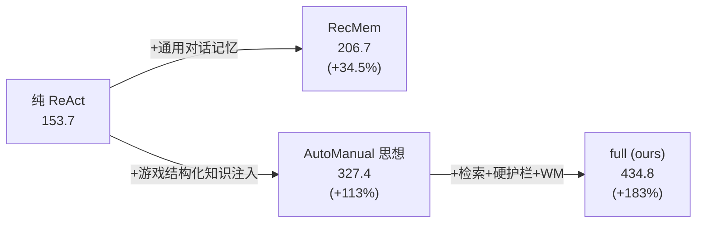

# 方法对比:记忆机制 × Jericho 得分

## 0. EvoTest 工程三基线原理(源码级解读)

> 以下三方案来自 `/mnt/data/EvoTest/src/`,实现均极简(<400 行),与同一 ReAct 决策骨架共用动作格式(REASONING/ACTION)。**关键共性:三者都只在局内(episode)起作用——`start_episode()` 清空全部状态,无任何跨局积累**。

### memory(滑动窗口记忆, src/memory_agent.py, 105 行)

**机制**: 维护一个 `(state, response)` 对的列表,超出 `max_memory=30` 时淘汰最旧条目(`pop(0)`,FIFO);每步把全部保留条目**原文**拼进 system prompt("MEMORY (Recent few states and agent's responses)")。

- 零 LLM 辅助、零压缩:记忆=最近 30 条原始观测+决策的 verbatim 堆叠
- 作用半径:只在同局内防重复、维持短期连贯;换局即失忆
- **原理定位**: 对应人类记忆的"工作记忆/感觉缓冲",是记忆的最朴素形态——这也是它成为对照组的原因:证明"有缓冲"与"有知识"是两回事

### summary(LLM 滚动摘要, src/summary_agent.py, 238 行)

**机制**: 在 memory 滑窗之外并行维护完整 `game_history`(state/action/reward/score 全记录);**每一步**都用摘要 LLM(独立温度 0.3)把全部历史压缩成 2-3 句"当前进度摘要"(聚焦:当前位置、已获物品、已解谜题、发现的线索),以 `GAME PROGRESS SUMMARY` 前缀注入 user prompt。

- LLM 失败时回退到启发式摘要(关键词匹配 found key/treasure/defeated + 步数)
- 摘要 prompt 只问"进展到哪了",**不提炼因果关系**(哪个动作导致得分/死亡)
- 换局同样清空(`start_episode` 重置 memory + game_history)
- **原理定位**: 对应"情节压缩"——比 verbatim 滑窗省 token 且保留长程梗概,但每步一次 LLM 调用的成本换来的只是**状态摘要而非经验知识**

### rag(局内 embedding 检索, src/rag_agent.py, 401 行)

**机制**: 同样记录完整 `game_history`,但对每条历史(状态+动作+响应+正则抽取的实体词)调用 `text-embedding-3-small` 向量化存成 numpy 矩阵;每步将**当前状态**向量化,与全部历史算余弦相似度,取 top-3(阈值 0.1)相似历史条目;再用一次 LLM 把检索到的历史合成为 2-3 句"可行动见解"(什么有效/无效、模式、建议下一步),连同原始检索片段注入 prompt。

- 检索是**相似状态召回**:"我在过的类似房间里当时做了什么"
- 换局清空索引(`start_episode` 重建空矩阵)——检索只在局内
- **原理定位**: 对应"情境线索提取"——这是 RecMem/本工程 wiki 检索的**局内退化版**:同样的向量检索思想,但(1)语料只有本局历史而非跨局知识,(2)检回的是原始交互而非提炼过的规则,(3)无固化/分层概念

### 三者对照的意义

| | memory | summary | rag | (对照)RecMem | (对照)full |
|---|---|---|---|---|---|
| 记忆形态 | 原文滑窗 | LLM 状态摘要 | 原文向量检索 | 三层:原文+情节+事实 | 结构化 wiki(知识/经验/世界模型) |
| 作用范围 | 仅局内 | 仅局内 | 仅局内 | **跨局累积** | **跨局累积** |
| 提炼"为什么" | ❌ | ❌(只摘"到哪了") | ❌(LLM 只合成建议) | 部分(语义层) | ✅(评分动作/死亡陷阱/房间条件) |
| 结果(avg) | 159.0 | 155.2 | 144.9 | 206.7 | **434.8** |

**一句话**: 三基线回答"局内上下文怎么给"(滑窗/摘要/检索三种给法),RecMem 与本工程回答"跨局经验如何变成知识"。前者的天花板是"本局玩得连贯"(~155),后者的收益来自"上一局学到的下一局还成立"(full 434.8)。

> 模型: GLM-5.2 | 协议: 6 游戏 × 10 局 × 110 步/局 | 日期: 2026-08-24
>
> 各方案共享同一 ReAct 决策骨架与逐步交互协议,差异在**记忆机制**。方案总览:
>
> | 方案 | 记忆机制 | 参考 |
>|---|---|---|
>| no_wiki (ReAct) | 无记忆,每局从零开始 | abl19_glm52_no_wiki(基线) |
>| RecMem | 通用对话记忆:递归触发固化 + 三层检索(subconscious/episodic/semantic, Qdrant),固化 prompt 为原版对话摘要风格 | **论文**: RecMem: Recurrence-based Memory Consolidation for Efficient and Effective Long-Running LLM Agents. *ACL 2026 Findings*. **代码**: https://github.com/CaiusDai/RecMem (abl24_glm52_recmem, 外部基线) |
>| AutoManual | 游戏结构化知识:策展纪律(预算+合并/三分支归因/[ok N/M] 验证标记)+ manual 全文注入 play prompt,零检索工具零硬护栏 | **论文**: AutoManual: Constructing Instruction Manuals by LLM Agents via Interactive Environmental Learning. *NeurIPS 2024*. arXiv:2405.16247. **代码**: https://github.com/minghchen/automanual (abl23_glm52_autom, 思想移植) |
>| memory | 滑动窗口原始记忆:保留最近 `max_memory=30` 条 (state, response) 原文拼入 prompt,无压缩无检索 | `/mnt/data/EvoTest`(src/memory_agent.py) |
>| summary | LLM 滚动摘要:每步用 LLM 把全部局内历史压缩成 2-3 句进度摘要注入 prompt(失败时回退启发式关键词摘要) | `/mnt/data/EvoTest`(src/summary_agent.py) |
>| rag | 局内 embedding 检索:全部历史向量化,按当前状态余弦相似度取 top-3 条历史,再经 LLM 合成"可行动见解"注入 | `/mnt/data/EvoTest`(src/rag_agent.py) |
>| EvoTest | prompt 进化 + 跨局记忆 + UCB 树搜索(本表最强的非本工程方案) | `/mnt/data/EvoTest`(src/our_agent.py) |
>| full(ours) | wiki 记忆管线:knowledge/experiences/world_model 分区 + 主动检索 + FATAL 硬拦截 + 循环检测 | abl19_glm52_full(本工程) |

---

## 1. 主表:每游戏得分(横轴=游戏,纵轴=方案)

### 1.1 平均分(avg,10 局平均)

| 方案 \ 游戏 | 模型 | 迭代次数 | Detective (max 360) | Library (max 30) | Zork1 (max 350) | Zork3 (max 7) | Balances (max 51) | Temple (max 35) | **TOTAL avg** | **vs ReAct** |
|---|---|---|---|---|---|---|---|---|---|---|
| no_wiki (ReAct, ours) | GLM-5.2 | 10 × 110 步 | 60.0 | 22.6 | 46.6 | 3.4 | 14.0 | 7.1 | **153.7** | 基线 |
| rag‡(EvoTest 工程) | GLM-5.2 | 10 × 110 步 | 82.0 | 9.0 | 40.7 | 2.4 | 5.5 | 5.3 | 144.9 | — |
| summary‡(EvoTest 工程) | GLM-5.2 | 10 × 110 步 | 76.0 | 11.4 | **48.0** | 2.6 | 11.0 | 6.2 | 155.2 | — |
| memory‡(EvoTest 工程) | GLM-5.2 | 10 × 110 步 | 93.0 | 10.0 | 38.9 | 2.4 | 8.5 | 6.2 | 159.0 | — |
| RecMem (abl24) [2] | GLM-5.2 | 10 × 110 步 | **118.0** | 19.5 | 46.5 | 2.3 | 10.5 | **9.9** | **206.7** | +34.5% |
| AutoManual (abl23) [1] | GLM-5.2 | 10 × 110 步 | **226.0** | 14.7 | 51.5 | 2.7 | **17.5** | **15.0** | **327.4** | +113% |
| EvoTest‡ [4](prompt 进化+UCB) | GLM-5.2 | 10 × 110 步 | **250.0** | 11.7 | 46.0 | 2.6 | 17.0 | 8.0 | **335.3** | — |
| EvoTest 论文§ [4] (G) | gemini-2.5-flash | 50 × 110 步 | 338.4 | 23.1 | 49.0 | 2.5 | 16.3 | 10.9 | 440.1 | — |
| EvoTest 论文§ [4] (C) | claude-4-sonnet | 50 × 110 步 | **342.0** | **24.0** | 56.0 | 2.7 | 17.9 | 11.9 | **454.4** | — |
| TALES 官网参考† [3] | claude-3.7-sonnet (thinking) | 单局(官网口径) | 259.2 | 11.4 | 49.0 | **4.34** | **24.48** | 12.6 | 360.9 | — |
| full (ours, abl19) | GLM-5.2 | 10 × 110 步 | **297.0** | **29.1** | **63.6** | **3.6** | **19.5** | **22.0** | **434.8** | **+183%** |

### 1.2 归一化得分(avg/max,%)

| 方案 \ 游戏 | Detective | Library | Zork1 | Zork3 | Balances | Temple | **均值** |
|---|---|---|---|---|---|---|---|
| no_wiki (ReAct) | 16.7% | 75.3% | 13.3% | 48.6% | 27.5% | 20.3% | 33.6% |
| rag‡ | 22.8% | 30.0% | 11.6% | 34.3% | 10.8% | 15.1% | 20.8% |
| summary‡ | 21.1% | 38.0% | **13.7%** | **37.1%** | 21.6% | 17.7% | 24.9% |
| memory‡ | 25.8% | 33.3% | 11.1% | 34.3% | 16.7% | 17.7% | 23.2% |
| EvoTest‡ | 69.4% | 39.0% | 13.1% | **37.1%** | 33.3% | 22.9% | 35.8% |
| EvoTest 论文§ [4] (G) | 94% | 77% | 14% | 35% | 32% | 31% | 47% |
| EvoTest 论文§ [4] (C) | **95%** | **80%** | 16% | 38% | 35% | 34% | **50%** |
| TALES 官网参考† (claude-3.7-sonnet thinking) | 72% | 38% | 14% | **62%** | **48%** | 36% | 45.0% |
| full (ours) | 82.5% | **97.0%** | 18.2% | 51.4% | 38.2% | 62.9% | 58.4% |

> † **TALES 官网参考口径说明**: 数据来自 [microsoft.github.io/tale-suite](https://microsoft.github.io/tale-suite/) 官方 leaderboard **Jericho 分游戏中 claude-3.7-sonnet (thinking) 的成绩**(该模型在官网总榜 Jericho 项为 12.5%,全集最强 o3 系列为 14-16%);为**单局评测口径,无跨局记忆累积**,与本表其余方案的"10 局迭代+记忆积累"协议不同,仅作绝对水平参照,不参与 vs ReAct 百分比计算。
>
> ‡ **EvoTest 工程方案口径说明**: 来自 `/mnt/data/EvoTest`(EvoTest [4] 的本地复现)(与本文四臂同用 GLM-5.2 × 10 局 × 110 步 × 同 6 游戏),采样设置略异——temp=0.4、关闭 thinking、固定 seed=0;其 memory/summary/rag 无跨局学习,EvoTest 本体带 prompt 进化。因基线协议不同,不计入 vs ReAct 百分比。
>
> § **EvoTest 论文成绩口径说明**: EvoTest 论文 [4] 报告的两个大模型成绩——(G) google/gemini-2.5-flash 与 (C) anthropic/claude-4-sonnet-20250522,**每游戏 50 次迭代 × 110 步**(本表其余方案均为 10 次迭代)。论文给分为归一化比率(表中原始分 = 比率 × 游戏 max 反算, TOTAL avg 为反算原始分之和;反算均值 0.47/0.50 与论文 Avg 一致)。5× 迭代预算与更强模型使其与 GLM-5.2 × 10 迭代的结果不构成严格对照,列为绝对水平参照:full(GLM-5.2, 仅 10 迭代)434.8 已达论文 G 440.1 的 98.8%、论文 C 454.4 的 95.7%。

### 1.3 最佳分(best,10 局最高)

| 方案 \ 游戏 | Detective | Library | Zork1 | Zork3 | Balances | Temple | **TOTAL best** |
|---|---|---|---|---|---|---|---|
| no_wiki (ReAct) | 130 | 30 | 64 | 5 | 20 | 13 | 262 |
| rag‡ | 120 | 10 | 59 | 4 | 10 | 8 | 211 |
| summary‡ | 130 | 17 | 50 | 4 | 20 | 8 | 229 |
| memory‡ | 130 | 10 | 59 | 3 | 10 | 8 | 220 |
| RecMem (abl24) | 200 | 21 | 64 | 3 | 20 | 15 | 323 |
| EvoTest‡ | 290 | 19 | 50 | 3 | 20 | 8 | 390 |
| AutoManual (abl23) | 350 | 30 | 85 | 4 | 20 | 20 | 509 |
| full (ours, abl19) | 340 | 30 | 99 | 5 | 20 | 25 | **519** |

> 注: Library 的 max 标注 30 但游戏实际可超出(abl22 纯 ReAct 出过 130 解局);Zork3 max=7 极小,得分差异意义有限。

---

## 2. 逐局序列(支撑 avg 的原始证据)

| 游戏 | 方案 | 10 局序列 |
|---|---|---|
| Detective | ReAct | —(abl19_no_wiki,见 phase_records) |
| | RecMem | 30, 190, 90, 90, 80, 40, 190, 200, 180, 90 |
| | AutoManual | 130, 230, 40, 330, 330, 250, 250, 350, **0**, 350 |
| | full | 130, 210, 330, 340, 340, 310, 330, 310, 340, 330 |
| Library | RecMem | 21, 19, 19, 16, 19, 19, 19, 21, 21, 21 |
| | AutoManual | 1, 21, 7, 28, 30, 30, **0**, 30, **0**, **0** |
| | full | 21, 30, 30, 30, 30, 30, 30, 30, 30, 30 |
| Zork1 | RecMem | 39, 64, 50, 45, 44, 45, 39, 50, 50, 39† |
| | AutoManual | 0, 54, 74, 80, **0**, 74, 85, 74, 74, **0** |
| | full | 54, 50, 74, 65, 85, 50, **0**, 85, 99, 74 |
| Balances | RecMem | 10, 5, 5, 5, 5, 10, 15, 15, 15, 20 |
| | AutoManual | 15, 20, 20, 20, 15, 20, 20, 20, 5, 20 |
| | full | 15, 20, 20, 20, 20, 20, 20, 20, 20, 20 |
| Temple | RecMem | 10, 15, 10, 10, 12, 10, 8, 8, 8, 8 |
| | AutoManual | 10, 0, 15, 20, 20, 20, 15, 15, 15, 20 |
| | full | 20, 5, 25, 25, 25, 25, 25, 20, 25, 25 |

† Zork1 RecMem ep10 于 94/110 步冻结(best=39 已计入)。

EvoTest 工程(memory/summary/rag/EvoTest)逐局序列见 `/mnt/data/EvoTest/logs/full_5agent_comparison.md`(数字已从源 JSON 复核)。代表性曲线: EvoTest detective `100,100,290,290,290,290,280,280,290,290`(ep3 进化出完整攻略后跳变);memory detective `130,20,120,130,120,110,120,130,20,30`(无跨局积累,波动)。

---

## 3. 关键模式

**与 TALES 官网参照的定位**: 参照数字为 claude-3.7-sonnet (thinking) 的单局无记忆成绩(归一化均值 45.0%),介于本表 AutoManual(40.4%)与 full(58.4%)之间——但两者协议不同:官网是前沿闭源模型单局评测,本表四臂是 GLM-5.2 十局记忆累积协议。两点可述:(1) claude-3.7 (thinking) 在 Balances(48%)和 Zork3(62%)上强于我们的所有记忆方案,说明这两局更吃模型固有能力而非经验积累;(2) Detective 上仅 full(82.5%)超过 claude-3.7 参照(72%),Library 上 full(97%)远超参照(38%)——**长线任务上,经验积累让 GLM-5.2 超过了无记忆的 claude-3.7-sonnet (thinking) 单局表现**,这是记忆系统价值的直接外部锚点。

**与 EvoTest 工程方案的跨套对比**: EvoTest 套件(memory/summary/rag/EvoTest)与本文四臂共享 GLM-5.2 × 10 局 × 110 步 × 同 6 游戏,仅采样设置略异(temp 0.4 / 关 thinking / 固定 seed)。其内部梯度与本表四臂的梯度**互为印证**:无跨局学习的记忆变体(memory 159.0 / summary 155.2 / rag 144.9)全部落在纯 ReAct(153.7)附近,工程内对比显示**任何记忆都能脱离无记忆的循环卡死,但天花板取决于知识形态**;只有带跨局进化/积累的机制才突破 300(EvoTest 335.3 / AutoManual 327.4 / full 434.8)。full 相对 EvoTest 的 +30%(434.8 vs 335.3)来自:Library 29.1 vs 11.7(结构化 ordering 知识)、Temple 22.0 vs 8.0(room-scoped 知识 + FATAL)、Balances 19.5 vs 17.0——EvoTest 靠 prompt 进化拿到 detective 类路线型游戏的高分,但在精确序列与多分支任务上不如显式结构化知识。注意 EvoTest 协议关 thinking,其数字对 GLM-5.2 略保守。

**阶梯结构**: 两条记忆路线从同一起点出发——通用对话记忆(+34.5%)与游戏结构化知识(+113%)相差 3.3 倍;full 在 AutoManual 思想之上再加主动检索、FATAL 硬拦截与世界模型,又 +33%。**记忆的收益不取决于"有没有记忆",而取决于知识的结构语义(位置条件化、致命性标注、可靠性验证)**。

**分游戏交叉验证**:
- **Detective**(线性路线,宽容): 三档记忆全部有效(118/226/297),梯度最清晰——是记忆机制差异的最佳展示场
- **Balances**(顺序施法): RecMem 逐局爬升(10→20)但天花板低;AutoManual 与 full 都稳定拿 20——结构化 ordering 知识的直接价值
- **Library**(精确序列,零容错): RecMem 与 AutoManual **均低于** ReAct(19.5/14.7 vs 22.6)——速通型记忆+零容错的共同风险;full 靠 FATAL 拦截 + 主动检索避免 0 分局,是唯一大幅领先的方案(29.1)
- **Zork1**(开放探索,随机死亡): AutoManual 与 full 都有 0 分局(bat 抢夺/随机事件),RecMem 稳定但天花板低;硬护栏缺失时记忆无法保证下限
- **Zork3/Temple**: 分值小/差异小,方向上 full ≥ AutoManual > RecMem ≈ ReAct

---

## 4. 数据来源与复现

| 方案 | 数据目录 |
|---|---|
| no_wiki (ReAct) | `~/AGIAgent_jericho/data/benchmark_results/abl19_glm52_no_wiki/` |
| EvoTest 工程(memory/summary/rag/EvoTest) | `/mnt/data/EvoTest/output/<game>/<agent>/glm-5.2/<ts>/evaluation_summary_*.json`;汇总 `/mnt/data/EvoTest/logs/full_5agent_comparison.md` |

汇总脚本: `~/RecMem/analyze_ablation24.py`(RecMem vs abl22/23/19);其余各臂见 `ablations_summary.md` §4 命令。

详细文档:
- AutoManual 思想移植: `abl23_autom_experiment.md`(理论/实现/逐局/与 full 分层对比)
- RecMem 适配: `~/RecMem/RECMEM_JERICHO.md`(部署/适配/验证/勘误记录)
- 消融总表: `ablations_summary.md`

> ⚠️ 口径说明: ReAct 基线本文取 abl19_no_wiki(带脚手架的 Naive ReAct,153.7);另有 abl22 纯 ReAct(去脚手架,184.8)。若以 abl22 为基线,RecMem +11.9%、AutoManual +77%、full +135%——阶梯结论不变。RecMem 首轮数据(198.4)因适配器 bug 作废,已勘误,详见 `ablations_summary.md` §3.4。

## 参考文献

1. Chen, M., Li, Y., Yang, Y., Yu, S., Lin, B., & He, X. **AutoManual: Constructing Instruction Manuals by LLM Agents via Interactive Environmental Learning.** *NeurIPS 2024*. [arXiv:2405.16247](https://arxiv.org/abs/2405.16247) | [代码](https://github.com/minghchen/automanual)
2. Dai, C. et al. **RecMem: Recurrence-based Memory Consolidation for Efficient and Effective Long-Running LLM Agents.** *ACL 2026 Findings*. [代码](https://github.com/CaiusDai/RecMem)(暂无公开 arXiv 链接,以 repo README 为准)
3. TALES: **the Text Adventure Learning Environment Suite** (Microsoft). Leaderboard: [microsoft.github.io/tale-suite](https://microsoft.github.io/tale-suite/) | 环境: [github.com/microsoft/tale-suite](https://github.com/microsoft/tale-suite) | 游戏引擎: Hausknecht et al., *Interactive Fiction Games: A Colossal Adventure* (arXiv:1909.05398)

4. **EvoTest: Evolutionary Test-Time Learning for Self-Improving Agentic Systems.** arXiv:2510.13220. [论文](https://arxiv.org/abs/2510.13220)
