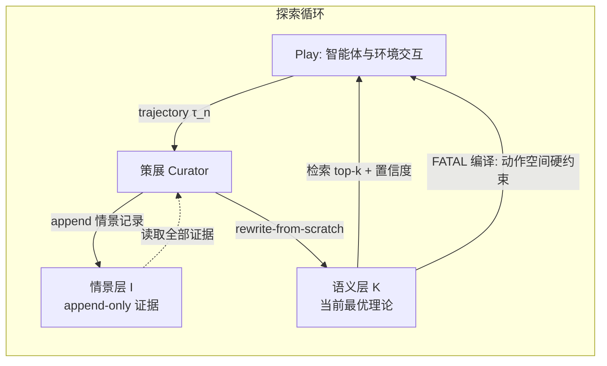

# 研究框架严格表述：探索中的知识积累

> 本文给出统一的研究定位、核心主张、创新点的严格描述与双平台验证设计。定位供论文引言与方法章节直接取用。
>
> 状态声明：Jericho 平台的全部实验已完成（6 游戏 × 5 条件 × 10 迭代 × 110 步）；ScienceWorld 平台的迭代管线代码已就绪（`apps/scienceworld/scienceworld_evolve.sh`，任务已选定 285/299/33/59/115）但 Wiki-Evolve 式实验**尚未运行**——早期 BIAgent 架构在 valid 集上有 67% 胜率的服务器结果，属另一系统，不能作为本框架证据。

---

## 一、研究问题与核心主张

### 1.1 研究问题

**开放环境中的智能体如何在持续探索中积累可靠知识？**

具体分解为三个子问题：

- **Q1（提取）**：交互经历（trajectory）如何转化为可复用的知识？纯神经方法（LLM 直接总结）会引入幻觉与信息丢失，纯符号方法无法处理非结构化观察。
- **Q2（可靠性））**：自主积累的知识如何保证可追溯、可验证、可修正？LLM 自由生成的知识库无法区分"验证过的事实"与"编造的策略"。
- **Q3（使用）**：积累的知识如何在后续探索中被安全使用？正向知识（怎么做）与负向知识（什么致命）的使用方式本质不同——前者应作为参考，后者应作为硬约束。

### 1.2 核心主张

**知识积累应作为一个独立于模型参数与会话上下文的外部过程，其组织方式遵循"证据—理论"分离原则：经历层作为不可变的证据基础单调增长，知识层作为当前最优理论在证据之上迭代重构；提取过程采用神经—符号分工（程序保证精确性，LLM 保证综合性）；使用过程对正向知识采用检索参考、对负向知识采用动作空间硬约束。**

一句话版本：**让智能体像科学家一样在探索中积累知识——完整保留实验记录，周期性重写综述，引用可溯源，安全条例强制执行。**

### 1.3 为什么需要两个验证平台

知识积累机制的普适性必须在不同性质的探索任务上检验：

| 维度 | Jericho（文字冒险） | ScienceWorld（科学探索） |
|---|---|---|
| 任务性质 | 智能体**生存**与任务完成 | **科学探索**任务（混合、凝固、融化、电路） |
| 环境特征 | 稀疏奖励、随机种子、不可逆死亡 | 结构化对象、可组合操作、部分可观测状态 |
| 知识形态 | 空间路径 + 危险禁令（负面知识密集） | 因果程序 + 实验配方（程序性知识密集） |
| 致命性 | 死亡终止整局（负向知识价值极端化） | 错误操作仅浪费时间（正向知识主导） |
| 验证目标 | 负向知识编码、硬拦截、有界探索 | 程序性知识迭代、配方合成、验证反馈 |

两平台互补：Jericho 是负向知识与生存约束的极端测试场；ScienceWorld 是正向程序性知识与因果知识积累的测试场。**同一套知识固化机制若在两类任务上都产生增益，则支持"探索中的知识积累"是任务无关的通用原理，而非特定游戏类型的工程调优。**

---

## 二、四项创新的严格表述

### 创新 1：脑启发的两阶段知识固化——情景增量、语义迭代

**机制描述**。记忆分为两层，写入协议根本不同：

$$\mathcal{I}^{(n)} = \mathcal{I}^{(n-1)} \cup \text{Distill}_{epi}(\tau_n) \quad \text{（情景层：append-only 增量）}$$

$$\mathcal{K}^{(n)} = \text{Rewrite}\big(\mathcal{K}^{(n-1)},\ \mathcal{I}^{(n)},\ \text{Extract}_{prog}(\tau_n)\big) \quad \text{（语义层：从零重写的迭代）}$$

- **情景层（experiences）**：每次交互结束后追加一条结构化情景记录（得分、路径、死因、关键发现），**永不改写、永不删除**。对应海马体式的快速、完整、一次写入固化——它是审计基准。
- **语义层（knowledge）**：策展者读取**全部**情景记录与上代语义知识，**从零重写**当前最优知识（上限 800 词）。迭代包含三类操作：（i）**验证反馈**——被复现的条目累积 Evidence 引用计数；（ii）**方案重整理**——碎片化的发现被重组为完整有序策略（如"钥匙在桌上"+"锁门在北侧"→"take key → north → open door"）；（iii）**隐性遗忘**——被证伪或过时的内容不被重新写出，冲突消解被生成协议吸收而无需显式实现。

**与现有工作的差异**。Reflexion 每轮写单轮反思、无跨轮合成；GLoW 保留完整轨迹但只做值估计、不合成结构化策略；SAMem/JitRL 维护扁平 $(s,a)$ 表、无层级。本方案的关键差异是**两种写入协议的显式分离**：证据不可变 + 理论可重构，这带来大小有界（语义层防膨胀）、无冲突累积（理论更替无补丁）、可重建性（语义层是情景层的物化视图）三个可证明性质。

**实证支撑**。abl19_glm52_full：迭代 10 轮，Detective 从 130（attempt 1）收敛至稳定 330-350；跨游戏 TOTAL 432.8 vs 无知识基线 178.7。

### 创新 2：可靠知识——语义到情景的溯源链接

**机制描述**。语义层每一条知识 $k$ 强制携带溯源链接集：

$$E(k) = \{e \mid e \in \mathcal{I},\ k \text{ 的断言由情景记录 } e \text{支撑}\}$$

链接同时承担三重功能：（i）**审计**——任何 distilled 断言可回溯至产生它的原始经历段，可定位蒸馏错误引入的位置；（ii）**验证计数**——$|E(k)|$ 即独立复现次数，被检索系统解析为置信度乘子（Confirmed-In ≥3 → 1.0，未验证 → 0.7，诚实失败 → 0.6），**验证历史直接编译进未来检索可见性**；（iii）**时间线索引**——链接路径含日期，构成知识的时间演化轴。

**可靠性保证**。由于语义层的生成协议是"读取全部情景证据重写"，情景层完整保留，故语义层任意一代都**可从情景层重建**（物化视图性质）——知识库的可靠性不依赖任何一代策展的质量，只依赖证据层的完整性，而证据层按协议不可损坏。

**与现有工作的差异**。Reflexion/Voyager 的记忆无来源标注；SAMem 的 Q 值是聚合量、丢失支撑经历；标准 RAG 无置信度维度。数据级 provenance（链接指向具体情景条目而非模糊的"历史经验"）在 Agent 记忆文献中未见先例。

**实证支撑**。实测 abl19 Detective 知识文件 24 条策略全部携带合规 Evidence 链接；检索系统按链接计数分化置信度并影响排序。

### 创新 3：神经—符号分工提取——程序捕获精确参数，LLM 负责合并整理

**机制描述**。策展阶段的信息流被显式划分为两个信任边界分明的通道：

- **符号通道（程序化提取）**：分数增量、触发动作、执行房间（正则 `<<\s*(.+?)\s*>>` 解析观察首行）、死亡事件（done ∧ ¬won）由代码从 trajectory.jsonl 确定性提取，生成结构化摘要并**禁止 LLM 重新解析原始轨迹**（prompt 明示 "do NOT re-parse the trajectory file"）。
- **神经通道（LLM 合成）**：LLM 只做跨条目合成——拼接因果碎片、推断顺序依赖、识别矛盾、压缩重写。

**设计原理**。LLM 幻觉无法伪造数值事实（"+10 分"），因为它从不接触数值事实的转写；LLM 的归纳能力（碎片→策略）被用在程序不可替代的位置。这对应科学实践中"仪器读数直接进论文、不经人手转写"的原则。

**与现有工作的差异**。EvoTest 的 Evolver、GLoW 的值估计、Reflexion 的反思均让 LLM 直接阅读原始交互记录并自行回忆/总结发生了什么——数值细节的忠实性完全依赖 LLM 转述。"程序化预提取 + 禁止 LLM 重解析"的策展分工未见先例。

### 创新 4：负向知识的一等公民地位与有界探索

**机制描述**。负向知识（什么会杀死你）不是正向知识的附属注释，而是独立的编码、编译与执行闭环：

- **编码规则**（防止误伤）：仅"在任何情形下都不得分"的动作才标记 [FATAL]（有时得分有时致死的条件性动作归入待探索）；FATAL 条目必须绑定**执行房间**（非目标房间）；房间未知时导航类 FATAL 不生效。
- **运行时编译**（记忆→动作空间）：知识文件中的 FATAL 条目在工具执行层被解析（按 mtime 缓存），匹配的动作在发送给环境**之前**被硬拦截并返回替代指令——知识不只进入 prompt（软影响），而是**改写智能体的可行动作集合**（硬约束）。
- **有界探索**：探索范围被两类知识共同约束——路径知识（已验证的得分路线）收敛探索方向，禁令知识（FATAL 拦截）划定探索边界。探索因此是**有界的**：在已知安全区内自由、在禁区外被强制阻止。

**与现有工作的差异**。RL 中死亡是标量惩罚信号；现有 Agent 记忆系统（MemGPT/Voyager/SAMem）无任何将记忆条目编译为运行时约束的机制。最接近的类比是 shielded RL 的动作掩码，但其约束来自预定义安全函数，而此处约束是**智能体自己从死亡经历中策展的**（self-curated shield）。

**实证支撑**。反事实消融（仅移除 FATAL 拦截，其余配置不变）：Detective 297→165（-44%）；知识路径引导防 9/10 死亡、硬拦截兜底 5/10，二者大部分重叠——护栏的定位是保险机制而非性能主引擎。

---

## 三、统一框架（机制的整合视图）

四项创新分别对应这个闭环的四个环节：**创新 1 定义了积累的形态**（双层协议），**创新 2 保证了积累的可靠性**（溯源），**创新 3 实现了积累的提取**（神经—符号分工），**创新 4 规范了积累的使用**（正参考负约束）。去掉任何一环，闭环退化：无溯源则知识不可信；无符号通道则数值失真；无负向约束则探索无界（死亡循环）。

---

## 四、双平台验证设计

### 4.1 平台一：Jericho——智能体生存与任务完成

**已完成的实验矩阵**（GLM-5.2，6 游戏：Detective/Library/Zork1/Zork3/Balances/Temple，10 迭代 × 110 步，随机种子）：

| 条件 | 配置 | TOTAL avg | 验证的机制 |
|---|---|---|---|
| full | 全部机制 | 432.8 | 整体闭环 |
| Exp-only | 仅情景层检索（无语义层、无 FATAL） | 379.5 | 创新 1（情景层的价值） |
| Naive ReAct | 无任何记忆 | 152.7 | 基线 |
| 纯 ReAct | 无记忆 + 无行为脚手架 | 178.7 | 基线校准（脚手架无用） |
| WM-only | 仅 episode 内工作记忆 | 180.1 | 负结果（与交互流冗余的记忆无生存空间） |
| full − FATAL | 移除硬拦截（反事实） | Detective -44% | 创新 4 |

**关键结论**（每条对应一个创新）：
1. 双层闭环整体 +183% vs 基线（创新 1 的有效性）；情景层单独即贡献 88%（增量证据的价值），语义层蒸馏在顺序敏感任务上边际收益最大（Library +82%——迭代重写将分散多轮的顺序约束固化为显式规则）（创新 1 的迭代价值）。
2. 行为脚手架（探索启发式 prompt + 循环检测）净贡献为负（178.7 vs 152.7）——**学习投资在知识层优于 prompt 层**，与 EvoTest 的配置演化路线形成对照。
3. 硬拦截反事实 -44%，且与路径知识冗余（保险机制）（创新 4）。
4. 诚实负结果：与交互流信息冗余的记忆层（WM 图）无生存空间——这为"记忆层必须提供不可从交互流推导的独占信息"提供了反例支撑。

### 4.2 平台二：ScienceWorld——科学探索任务

**定位**。检验同一套知识固化机制在**程序性、因果性**知识上的积累能力：化学混合（chemistry-mix，配色）、物态变化（freeze/melt）、电路分类（power-component）等任务的探索中，情景层记录实验组合与结果，语义层迭代重构"实验配方"（如 secondary color = mix(primary_a, primary_b) 的因果规则）。

**已就绪组件**：
- 迭代管线：`apps/scienceworld/run_all_tasks.py`（play→phasem 循环，与 Jericho 同构）
- 任务选择：5 个多样性任务（idx 285/299/33/59/115，基线完成率 3%–60% 跨度覆盖不同难度）
- 启动脚本：`scienceworld_evolve.sh`（100 步 play / 15 步 phasem / 10 迭代）

**待运行实验**（与 Jericho 矩阵对齐）：
| 条件 | 验证目标 |
|---|---|
| full | 闭环整体增益（对比官方基线完成率） |
| Exp-only | 情景层（实验记录）单独的价值 |
| no_wiki | 无记忆基线 |
| full − FATAL | 不适用（ScienceWorld 无死亡）→ 改为移除配方验证计数，检验创新 2 在正向知识上的作用 |

**预注册假设**（基于 Jericho 结论的外推，待检验）：
- H1：知识积累增益在低基线任务（3%–30%）上最大——探索空间大、重复试错成本高。
- H2：语义层（配方迭代）的边际价值高于 Jericho——科学任务的顺序与组合约束更密集，重写式蒸馏的固化优势更强。
- H3：溯源链接的验证计数在 ScienceWorld 上更关键——同一配方在不同初始物质上成败混合，无验证计数的知识库会被偶然成功污染。

---

## 五、贡献清单（论文 claim 列表）

1. **问题层面**：提出"探索中的知识积累"作为测试时学习的研究框架，并论证其与参数层/会话层/配置层/轨迹层学习路线的正交性。
2. **方法层面**：
   - (a) 增量情景 / 迭代语义的双层固化协议（创新 1）
   - (b) 数据级溯源链接及其"验证历史→检索置信度"编译（创新 2）
   - (c) 策展的神经—符号信任边界（创新 3）
   - (d) 负向知识编码 + 动作空间硬编译的有界探索（创新 4）
3. **实证层面**：Jericho 五条件 + 反事实消融定量验证各机制贡献；ScienceWorld 跨平台验证机制的任务无关性（待完成）。
4. **认识层面**：两个 design lesson——(i) 记忆层生存条件（必须提供交互流不可推导的独占信息，WM 负结果）；(ii) 蒸馏回本条件（任务的动作顺序敏感度，Library/Temple vs Detective 的边际收益分化）。

---

## 六、术语表（中英对照，供论文统一用词）

| 中文 | 英文 | 定义 |
|---|---|---|
| 情景层 | episodic layer (experiences) | append-only 的原始交互证据库 |
| 语义层 | semantic layer (knowledge) | 每轮从零重写的当前最优知识 |
| 策展 | curation | 轨迹→知识层的离线固化过程 |
| 溯源链接 | provenance link (Evidence link) | 语义条目指向情景条目的引用 |
| 验证计数 | verification count | 溯源链接数，即独立复现次数 |
| 从零重写 | rewrite-from-scratch | 语义层每轮基于全部证据重新生成 |
| 负向知识 | negative knowledge | 描述危险/致命动作的知识（FATAL 条目） |
| 动作空间编译 | action-space compilation | 知识条目转化为运行时硬约束 |
| 有界探索 | bounded exploration | 路径知识与禁令知识共同约束的探索 |
| 物化视图 | materialized view | 语义层可由情景层完全重建的性质 |
