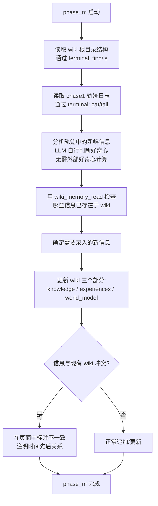

# Wiki 记忆系统重构设计

## 1. 背景与动机

当前 BIAgent 的记忆系统由三套平行子系统构成，数据散落在大量 JSON/JSONL 文件中，不直观且维护困难：

| 子系统 | 存储路径 | 作用 |
|---|---|---|
| biagent/ | `biagent_memory/<exp>/<app>/<env>/` | scene→curiosity→world_graph+skill_graph 流水线 |
| skill_evolve/ GraphSkillTools | `graph_experience/<exp>/` | graph_skill Markdown 增量更新 |
| skill_evolve/ WorldModelTools | `world_model_graph/<exp>/` | state_nodes 链 + scene packets |
| skill_evolve/ SkillTools | `experience/<exp>/` | 遗留经验链（服务所有 app） |

**问题**：JSON 不直观、正则提取噪声大、好奇心触发率低（实测 ~3%）、world graph 积累差。

**目标**：用一套 wiki 风格的记忆系统完全替换上述全部子系统。

---

## 2. 总体架构

### 2.1 三阶段流水线

```
phase1_explore (求解+探索)
    │
    │  轨迹上下文存盘（现有的 manager.log + score_summary.json）
    ▼
phase_m (记忆总结，新增)
    │  读取 wiki + 分析新轨迹 + 用好奇心指标筛选新信息 + 更新 wiki
    ▼
phase2_solve (求解)
    │  通过 wiki_memory_read (grep) 读取 wiki 辅助解题
```

- **phase1**：大模型只做任务求解，不调用任何记忆工具，不计算好奇心，不写 wiki。轨迹自然存盘。
- **phase_m**（memory phase）：phase1 轨迹存盘后自动触发的新阶段。大模型读取现有 wiki，分析新轨迹中的新鲜信息，更新 wiki 的三个主要部分。
- **phase2**：大模型通过 `wiki_memory_read` 工具（grep 模式）读取 wiki 辅助求解。

### 2.2 Wiki 目录结构

```
<wiki_root>/
├── _index.md                    # 总索引：列出所有页面及分类
├── knowledge/                   # 知识技能（skill）
│   ├── _index.md                # 本分类索引
│   ├── boil-water-recipe.md
│   ├── focus-before-transform.md
│   └── ...
├── experiences/                 # 曾经经历（时间轴）
│   ├── _index.md
│   └── 2026-06-19/              # 按日期组织
│       ├── boil-var14.md        # 单次任务的经历记录
│       └── freeze-var017.md
└── world_model/                 # 世界模型
    ├── _index.md
    ├── locations/               # 子空间（房间）页面
    │   ├── _index.md
    │   ├── kitchen.md           # 厨房页面：描述 + 连接到物体页面
    │   ├── hallway.md
    │   └── ...
    └── objects/                 # 物体页面（按需建立）
        ├── _index.md
        ├── stove.md             # 炉子：功能、位置、交互历史
        ├── freezer.md
        └── ...
```

### 2.3 页面格式

所有页面为 Markdown，含 YAML front-matter（元数据）+ 正文（自由格式）：

```markdown
---
page_type: location          # location | object | knowledge | experience
title: Kitchen
applies_to: [all]            # [all] 或 [boil, freeze, ...]
created: 2026-06-19T16:00:00Z
updated: 2026-06-19T16:30:00Z
links: [stove, oven, freezer, hallway]   # 页面间连接
sources: [boil-var14, freeze-var017]      # 来源经历
---

# Kitchen

厨房是一个有加热和制冷设备的房间。

## 物体
- [[stove]] - 加热设备，可以激活
- [[oven]] - 烤箱，需要先开门再放入物体
- [[freezer]] - 冷冻设备，里面有冰激凌

## 连通
- [[hallway]] - 通过门连接（需要先 open door）

## 交互历史
- 2026-06-19 boil-var14: 在厨房用 stove 成功煮沸了冰激凌
- 2026-06-19 freeze-var017: 在厨房 freezer 找到了冰
```

---

## 3. 工具设计

### 3.1 删除的工具（全部移除）

- `trigger_curiosity` / `trigger_cur_curiosity` — 好奇心触发
- `query_skill` / `query_graph_skill` / `query_world_model` — embedding/TF-IDF 检索
- `write_skill` / `edit_skill` / `read_skill` / `list_skills` / `delete_skill` — skill CRUD
- `improve_graph_skill` — graph_skill 增量更新
- `rate_skill` / `copy_skill_files` — 遗留 skill 管理

### 3.2 新增工具

**`wiki_memory_read`**（phase2 + phase_m 可用）

- grep 模式搜索 wiki，不做 embedding
- 参数：`query`（搜索词）、`section`（可选：knowledge/experiences/world_model/all）
- 返回匹配的页面标题 + 相关行上下文
- 实现方式：调用 `grep -rn` 遍历 wiki 目录，返回匹配结果

此外，phase_m 阶段的智能体通过现有工具（terminal/shell 脚本等）直接读写 wiki 文件。不提供专门的写入工具——智能体用 `terminal` 工具操作文件系统。

### 3.3 工具注册门控

| Phase | 可用工具 |
|---|---|
| phase1_explore | `scienceworld_action` + 通用工具（terminal/web_search 等），**无记忆工具** |
| phase_m | `wiki_memory_read` + 通用工具（terminal 用于读写 wiki 文件） |
| phase2_solve | `scienceworld_action` + `wiki_memory_read` + 通用工具 |

---

## 4. phase_m 详细设计

### 4.1 触发时机

phase1 的每个任务完成后（轨迹存盘后），自动触发一次 phase_m。phase_m 是一个独立的 agent 会话，它的输入是：

1. 刚完成的 phase1 轨迹日志路径
2. wiki 根目录路径
3. 当前 wiki 结构概览（目录树）

### 4.2 phase_m 执行流程



### 4.3 phase_m 提示词要点

phase_m 的系统提示词需要告知智能体：

1. **wiki 根目录路径**和基础结构（三部分 + 页面格式约定）
2. 它的任务是分析 phase1 轨迹，提取新鲜信息，更新 wiki
3. **好奇心判断由 LLM 自行完成**——它需要自己判断哪些是"新发现"（新房间、新物体、新机制、新约束、新失败模式、新恢复路径、新得分路径）
4. **冲突处理**：如果新信息与现有 wiki 不一致，不要删除旧信息，而是把多种说法都标记进去，注明时间先后
5. 可以使用 terminal 工具直接操作 wiki 文件系统（mkdir/cat/sed/echo 等）
6. 可以使用 wiki_memory_read 工具搜索现有 wiki 内容

### 4.4 冲突处理策略

| 场景 | 处理方式 |
|---|---|
| 房间连通性矛盾 | 两边都记录，注明来源经历和时间 |
| 物体功能描述不同 | 保留多种描述，标注"存在分歧" |
| 物体位置不同 | 记录为"物体可能出现在 A 或 B"，注明各自来源 |
| 操作步骤冲突 | 各记录为独立的方法，不互相覆盖 |

**核心原则**：wiki 信息只增不删，冲突时追加而非覆盖。

---

## 5. 删除清单

### 5.1 代码文件（完全删除）

- `src/biagent/` 整个目录（~2,100 行）
- `src/skill_evolve/` 整个目录（~3,800 行）
- `apps/scienceworld/world_understanding_evaluator.py`
- `apps/scienceworld/run_wue_on_batch.py`
- `apps/scienceworld/docs/wue_usage.md`

### 5.2 代码文件（部分删除/重写）

- `src/tool_executor.py` — 删除 ~1,000 行记忆相关代码（trigger_curiosity、所有 query/write_skill 工具注册、好奇心提取方法、asset lock、phase 门控），保留 scienceworld_action + 通用工具 + MCP
- `src/tools/scienceworld_tools.py` — 删除 BIAgentPaths 导入 + build_memory_scope_key（~2 行），保留全部 ScienceWorldEnv 交互逻辑
- `apps/scienceworld/run_all_tasks.py` — 重写 requirement 函数（删除好奇心/skill/检索指令），新增 phase_m 模式

### 5.3 Prompt 文件

- `system_prompt.txt` / `rules_prompt.txt` / `tool_prompt.json` — **重写**（删除好奇心/skill/检索指令，加入 wiki 读取指引）
- `memory_tools.json` / `graph_skill_prompts.yaml` / `world_model_prompts.yaml` / `scene_reflection_prompts.yaml` — **删除**
- 新建 `phase_m_prompt.txt`

### 5.4 数据目录（完全删除）

- `data/default/general/biagent_memory/`
- `data/default/general/graph_experience/`
- `data/default/general/world_model_graph/`
- `data/default/general/_curiosity_runtime/`
- `data/default/general/_asset_update_locks/`
- `data/default/general/experience/`

### 5.5 其他

- `tests/test_scienceworld_entry.py` — 重写
- `apps/scienceworld/HANDOFF.md` / `README.md` / `BIAgent.md` — 重写

---

## 6. 实施阶段

### 阶段 1：清理（删除旧系统）
- 删除 `src/biagent/` 目录
- 删除 `src/skill_evolve/` 整个目录
- 清理 `tool_executor.py` 中的 ~1,000 行
- 清理 `scienceworld_tools.py` 中的 BIAgentPaths 引用
- 删除旧 prompt 文件 + 旧数据目录

### 阶段 2：新建 wiki 基础设施
- 新建 `src/wiki_memory.py`（wiki_memory_read 工具实现）
- 新建 `apps/scienceworld/prompts/phase_m_prompt.txt`
- 重写 `tool_prompt.json`（只保留 scienceworld_action + wiki_memory_read）
- 重写 `system_prompt.txt` 和 `rules_prompt.txt`

### 阶段 3：phase_m 集成
- 在 `run_all_tasks.py` 中新增 phase_m 模式
- `_run_task_two_stage` 改为 phase1 → phase_m → phase2
- 新增 `_phase_m_requirement` 函数
- 新增 `--phase-m-loops` CLI 参数

### 阶段 4：测试与文档
- 重写 `test_scienceworld_entry.py`
- 重写 `HANDOFF.md` / `README.md` / `BIAgent.md`
- 端到端验证

---

## 7. 已确认决策

| 决策项 | 选择 | 影响 |
|---|---|---|
| **替换范围** | 全局替换 | 删除 `src/skill_evolve/` 整个目录 + `experience/` 数据。所有 app 的 skill 存储统一走 wiki |
| **phase_m 触发** | 每个 phase1 任务后 | `_run_task_two_stage` 改为 phase1 → phase_m → phase_m → phase2 三段串联 |
| **wiki 作用域** | 全局共享 + 标签区分 | 所有 ScienceWorld 任务共享一个 wiki 根目录。页面 front-matter 标注 `applies_to` |
| **WUE 评估器** | 删除 | 删除 world_understanding_evaluator.py + run_wue_on_batch.py + docs/wue_usage.md |

### 7.1 全局共享 wiki 结构

```
data/default/general/wiki/<experiment_name>/
├── _index.md
├── knowledge/
│   ├── _index.md
│   └── *.md                   # applies_to 标签区分适用任务
├── experiences/
│   ├── _index.md
│   └── YYYY-MM-DD/
│       └── <env>-var<N>.md
└── world_model/
    ├── _index.md
    ├── locations/
    │   ├── _index.md
    │   └── *.md               # 房间页面，applies_to: [all]
    └── objects/
        ├── _index.md
        └── *.md               # 物体页面
```

phase2 的 `wiki_memory_read` 检索时结合当前 env_name 过滤：先 grep 全局，再按 `applies_to` 匹配当前任务优先排序。
